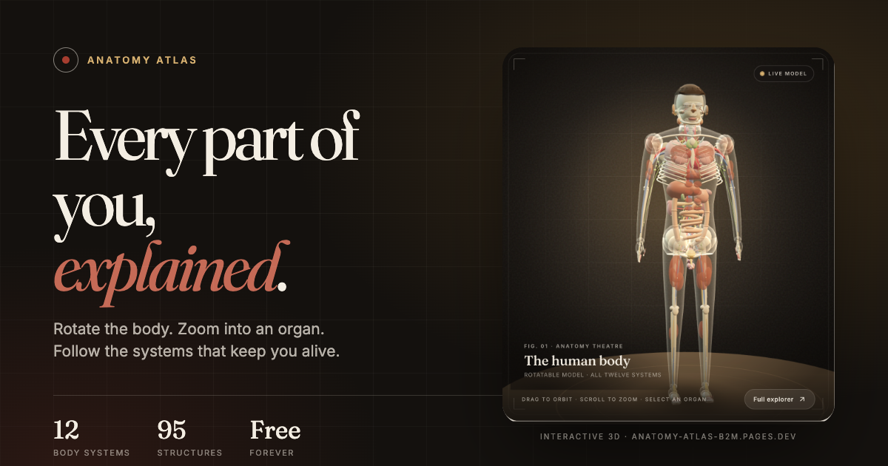

# Anatomy Atlas

An interactive 3D atlas of the human body — explore every system and organ, zoom into the details,
follow guided lessons, and test yourself with explained quizzes.

**Live:** https://anatomy-atlas-b2m.pages.dev
**Source:** https://github.com/shanto12/anatomy-atlas



## What it is

Anatomy Atlas is a free, browser-based learning platform for human anatomy. A stylized human body is rendered in
real time with Three.js: rotate it, zoom in, switch between the twelve body systems, and click any organ to read an
authoritative, plain-English entry. Around the explorer sit twelve guided lessons, a quiz engine with explanations,
a searchable glossary, and a body-region index.

- **3D body explorer** — orbit, zoom, pan, system layers, skin/skeleton toggles, click-to-inspect, focus-on-organ.
- **~95 organ entries** — summaries, functions, location, size, facts, common conditions, related structures, and
  cited public-health sources.
- **12 systems** — skeletal, muscular, nervous, cardiovascular, respiratory, digestive, endocrine, immune/lymphatic,
  urinary, reproductive, integumentary, sensory.
- **Guided lessons** — eight steps per system, with organ-by-organ stops and progress saved locally.
- **Quizzes** — per-system quizzes plus a 24-question final exam; every answer is explained.
- **Glossary & search** — 120 terms, A–Z browsing, and ⌘K global search.
- **Responsive & accessible** — 360px through desktop, keyboard paths, reduced-motion support, canvas-free fallbacks.

Educational content only — not medical advice.

## Tech stack

- React 19 + TypeScript + Vite 6
- Three.js via @react-three/fiber 9 and @react-three/drei 10
- React Router 7
- Handcrafted CSS design system (Fraunces + Inter, self-hosted via Fontsource)
- Vitest + Playwright + axe-core for tests
- Cloudflare Pages for hosting

## Getting started

```bash
npm install
npm run dev        # http://localhost:5173
npm run build      # typecheck + production build
npm run preview    # preview the production build
npm run test       # unit tests (data integrity, search, quiz, progress)
npm run test:e2e   # Playwright end-to-end + accessibility tests
```

## Project structure

```
src/
  data/           # authored content: 12 system JSON files + glossary/facts/history/regions
  viewer/         # procedural anatomy model, organ geometry, materials
  components/     # viewer, UI primitives, layout, learning, search
  pages/          # one component per route
  lib/            # types, SEO, progress store, quiz, search
  styles/         # design tokens, base, UI, pages, viewer, learning
docs/             # content spec, architecture, teardown, QA and deployment reports
tests/            # Vitest unit suite + Playwright e2e suites
scripts/          # content validator, OG image generator, live verification
```

## Content

All educational content lives in `src/data/` as typed JSON. The schema, voice guide, required organ IDs, and
medical-safety rules are in [docs/CONTENT_SPEC.md](docs/CONTENT_SPEC.md). The validator (`npm run content:validate`)
enforces structure, cross-references, counts, and source domains.

Sources are public-health and anatomy references (MedlinePlus, NIH institutes, Cleveland Clinic, Mayo Clinic,
Johns Hopkins Medicine, Britannica, TeachMeAnatomy). Every organ entry cites two sources.

## Deployment

Cloudflare Pages, built from `dist/`:

```bash
CLOUDFLARE_ACCOUNT_ID=<account-id> npm run build
CLOUDFLARE_ACCOUNT_ID=<account-id> npx wrangler pages deploy dist --project-name anatomy-atlas --branch main
```

See [docs/DEPLOYMENT.md](docs/DEPLOYMENT.md). Netlify is also supported by the static build; the primary Netlify
account used during this build was credit-blocked for new deploys, so Cloudflare Pages is the canonical host.

## License

Code: MIT. Educational text is written for this project using public references; see the sources cited in each
entry. Do not use this atlas for diagnosis or treatment.
